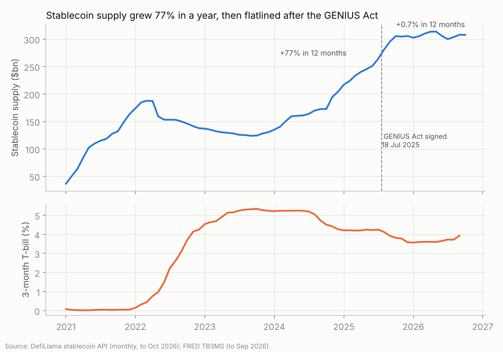
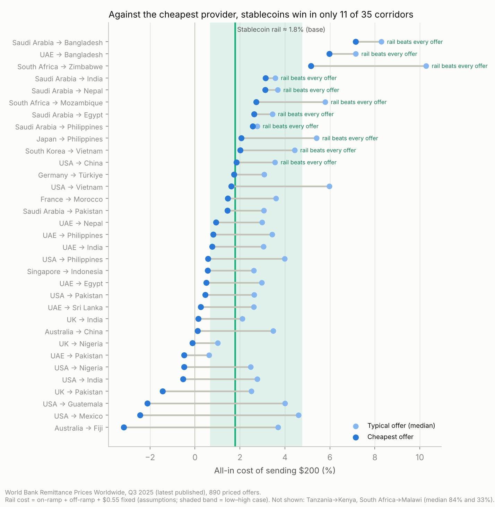
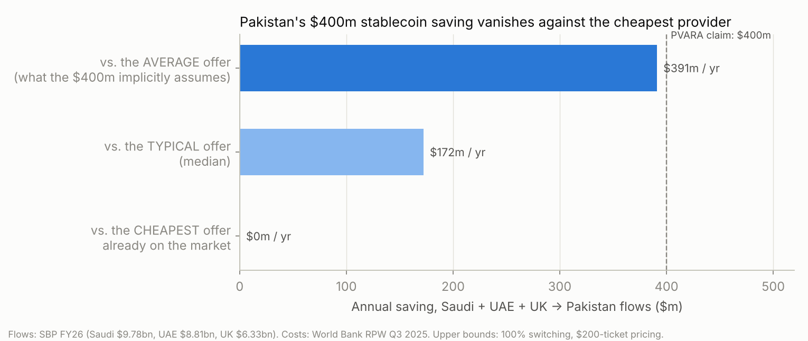

# Stablecoins vs SWIFT: where do stablecoins actually beat today's remittance providers?

*An analysis of 890 priced money-transfer offers across 35 corridors, plus two financial models. Data as of October 2026.*

> **In one line:** Stablecoins are cheaper than the *average* way of sending money home, but against the *cheapest* option people already have, they win in only **11 of 35** major corridors. Those 11 are concentrated in money sent **out of Saudi Arabia, within Southern Africa, and from Japan/Korea to Southeast Asia**, not in the famous US→Mexico route.

---

## Why this matters now (Oct 2026)
- **Remittances are among the largest financial flows reaching developing countries.** About **$685bn** reached low- and middle-income countries in 2024, more than foreign direct investment and aid combined. At the global average fee of **6.49%** to send $200, that implies up to about **$44bn a year** paid in fees (illustrative upper bound).
- **Stablecoins have become a payments system in their own right.** These are digital dollars such as USDT and USDC, each backed 1:1 by cash and Treasury bills. There are now about **$308bn** in circulation, and their 2025 settlement volume was larger than Visa's.
- **The rules were all set in the last few months:**
  - **US.** The GENIUS Act was signed in July 2025 and takes effect on **18 Jan 2027**. Treasury published its first implementing rule on **30 Sep 2026**, and regulators missed the July 2026 rulemaking deadline.
  - **Pakistan.** The new virtual-assets regulator, PVARA, said on **22 Aug 2026** that stablecoins could save the country about **$400m a year** on remittances.

## What's new in this analysis
Most public commentary, including the $400m claim, compares stablecoins with the **average** remittance price. Nobody sends money at the average price, though: they use whichever provider they can access. This project compares stablecoins with the **cheapest** and the **typical (median)** offer in every corridor, using the World Bank's provider-level price data.

---

## Finding 1: The stablecoin boom has stalled since the US law passed

| | Oct 2024 → Oct 2025 | Oct 2025 → Oct 2026 (rates to Sep 2026) |
|---|---|---|
| Stablecoin supply growth | **+77%** ($173bn → $306bn) | **+0.7%** ($306bn → $308bn) |
| US 3-month T-bill rate | 4.51% → 3.82% | 3.82% → 3.94% |

**In plain English:** the market nearly doubled in the year running up to the new US law, then stopped growing. The law passing was not the same as the law taking effect, and it does not take effect until January 2027.
**For the expert:** the plateau coincides with the gap between signing and effectiveness, with missed agency rulemaking deadlines, and with the 360-day federal-transition clock for issuers above $10bn. Market share is also shifting. USDT holds 59.6% and USDC 23.6%, but USDC fell from $75.3bn (end-2025) to $72.7bn (Oct 2026), while newer bank- and fintech-aligned coins (USD1, PYUSD, RLUSD, USDG) are taking share. Growth is now a fight over distribution, not over issuing more coins.

## Finding 2: Stablecoins beat the cheapest provider in only 11 of 35 corridors

The stablecoin route's base-case cost is about **1.8%**: 0.5% to buy the stablecoin, 1.0% to cash out into local currency, plus a fixed $0.55. That is cheaper than the **average** offer in 35 of 35 corridors, and than the **typical** offer in 33 of 35, but cheaper than the **cheapest** offer in only **11 of 35**.

**Where stablecoins win outright:**
- **Out of Saudi Arabia:** Bangladesh (cheapest offer 7.2%), India (3.1%), Nepal (3.1%), Egypt (2.6%), Philippines (2.6%).
- **Southern Africa:** South Africa → Zimbabwe (5.2%), South Africa → Mozambique (2.7%).
- **East Asia:** Japan → Philippines (2.1%), Korea → Vietnam (2.0%), USA → China (1.85%, marginal).
- **Saudi Arabia → Bangladesh:** worth singling out. Even its cheapest offer (7.2%) costs four times the stablecoin route.

**Where stablecoins lose:** the big, competitive corridors such as US→Mexico, US→India, UK→Pakistan and UAE→Pakistan. There, exchange houses and digital providers already charge **below zero to 1%**, often by subsidising the exchange rate.

**In plain English:** stablecoins are not a universal fix. They help most where competition between existing providers is weak.
**For the expert:** what matters is how competitive the corridor already is, not stablecoins' theoretical efficiency. Where Gulf exchange houses compete hard (UAE), they have already pushed prices to near zero. Saudi outbound corridors are far more concentrated: 9–12 priced offers each, versus 16–31 for most UAE and UK corridors. That makes them the most attractive place for stablecoins to attack.

## Finding 3: Pakistan's "$400m saving" exists only against the average price

These figures cover Pakistan's three largest corridors (Saudi Arabia, UAE and UK), $24.9bn of the $41.6bn received in FY26. They assume a 100% switch to stablecoins and are therefore upper bounds:

| Benchmark | Annual saving |
|---|---|
| vs **average** offer | **$391m** (matches PVARA's ~$400m) |
| vs **typical** (median) offer | **$172m** |
| vs **cheapest** offer already available | **$0** (Saudi Arabia→Pakistan already has a 1.44% offer) |

**81%** of the "average" saving sits in **one corridor, Saudi Arabia → Pakistan**.

**In plain English:** most of the saving Pakistan is hoping for could come from getting people in Saudi Arabia onto the cheapest existing app. The technology itself is not the bottleneck.
**For the expert:** what blocks the saving is distribution and awareness, not the payment rail. Two policy levers follow:
- a price-comparison mandate in the Saudi corridor, combined with targeting the existing remittance-incentive scheme at the cheapest channels;
- stablecoin rails as a competitive threat that pushes incumbents to cut prices, rather than as a replacement for them.

## Finding 4: The rate-cut squeeze, and why stablecoin issuers need payments volume
Model: `model/stablecoin_model.xlsx` → *Issuer P&L*. It is calibrated to Circle's FY2025 and Q2 2026 results.

| For a USDC-sized issuer (~$73bn) | Today (3.94%) | −50bp | −100bp | −150bp |
|---|---|---|---|---|
| Reserve income ($m) | 2,876 | 2,511 | 2,146 | 1,781 |
| Adjusted EBITDA ($m) | 718 | 574 | 430 | 286 |
| Payment volume needed to replace lost EBITDA at a 10bp fee ($bn/yr) | – | 144 | **288** | 433 |

**In plain English:** stablecoin issuers earn money mainly by holding your dollar in Treasury bills, and about 60% of that interest goes to the partners who distribute the coins. When interest rates fall, profits fall fast.
**For the expert:** a 100bp rate cut removes about $730m of reserve income and about $290m of EBITDA. Replacing that with payments revenue at a 10bp fee requires about **$290bn a year** of payment volume, around **42% of all remittances to developing countries**. That is why issuers are racing to own payment networks rather than just issuing coins. It also explains the corridor-selection logic in Finding 2.

## Finding 5: A Saudi → South Asia stablecoin remittance product could work
Model: `model/stablecoin_model.xlsx` → *Corridor Product*. All inputs are assumptions and can be edited.

**Assumptions:**
- Price of **2.7%**, below the cheapest Saudi→Bangladesh offer (7.15%) and the cheapest Saudi→India and Saudi→Nepal offers (about 3.1%).
- Average transfer of $300, made 1.3 times a month.
- Customer acquisition cost of $22 and monthly churn of 4%.

**Outputs:**
- **$3.05** contribution per transfer.
- About **5.5 months** to pay back acquisition cost.
- Breaks even on EBITDA in year 5, at about 340k active users.
- 5-year NPV of −$4.6m at an 18% discount rate, before any terminal value. This is a scale business.
- A sender to Bangladesh saves about **$13 per $300 transfer** compared with the cheapest offer available today.

**Key risk:** licensing. Converting stablecoins to and from cash in Saudi Arabia and in the receiving countries needs regulated partners, and Saudi rules on crypto remain restrictive. Treat this as an option on regulation.

---

## Method and data
| Data | Source | Date |
|---|---|---|
| Stablecoin supply (monthly), by issuer and chain | DefiLlama stablecoin API | to Oct 2026 |
| 3-month T-bill rate | FRED TB3MS | to Sep 2026 |
| Issuer financials | Circle FY2025 results (SEC) and Q2 2026 results | Feb and Aug 2026 |
| Price of sending $200: 890 offers, 35 corridors (min / median / average) | World Bank Remittance Prices Worldwide | Q3 2025 (latest release) |
| Global remittance context | World Bank (Migration & Development; RPW Q1 2025 report) | 2024–25 |
| Pakistan inflows by country | State Bank of Pakistan, via Gulf News | FY26 |
| PVARA $400m claim | ProPakistani | 22 Aug 2026 |

**Limitations:**
- World Bank prices lag by about a year (Q3 2025 is the latest release). Gulf competition has likely pushed prices *lower* since, which would only strengthen Findings 2 and 3.
- The $200 benchmark overstates percentage costs for larger transfers.
- Stablecoin buy and cash-out costs are assumptions. Low, base and high cases are in `analysis.py` and in the model's Inputs sheet.
- The savings figures assume everyone switches, so they are upper bounds.

**Reproduce:** `pip install pandas matplotlib openpyxl && python analysis.py`. Change the assumptions at the top of `analysis.py` or in the blue cells of the model.

*Built by Saarim Rizwan Sadiq (LUMS Economics '26). All data public; views my own; not investment advice.*

### Sources
- DefiLlama stablecoins API: https://stablecoins.llama.fi
- FRED TB3MS: https://fred.stlouisfed.org/series/TB3MS
- Circle FY2025 results: https://www.sec.gov/Archives/edgar/data/1876042/000187604226000032/final_circlereportsfourt.htm
- Circle Q2 2026 results: https://www.circle.com/pressroom/circle-reports-second-quarter-2026-results
- World Bank RPW: https://remittanceprices.worldbank.org (corridor pages; Q1 2025 main report)
- World Bank, remittances 2024: https://blogs.worldbank.org/en/peoplemove/in-2024--remittance-flows-to-low--and-middle-income-countries-ar
- Gulf News, Pakistan FY26 remittances: https://gulfnews.com/world/asia/pakistan/saudi-arabia-uae-drive-pakistan-remittances-to-record-416bn-1.500602356
- ProPakistani, PVARA $400m: https://propakistani.pk/2026/08/22/pakistans-crypto-czar-eyes-400-million-remittance-savings-through-stablecoins/
- Yahoo Finance, Treasury's first GENIUS Act rule: https://finance.yahoo.com/markets/crypto/articles/treasury-first-genius-act-rule-073833593.html
- Blockeden, stablecoin volume vs Visa: https://blockeden.xyz/blog/2026/04/18/stablecoins-surpass-visa-315b-market-cap-33t-volume-genius-act/
